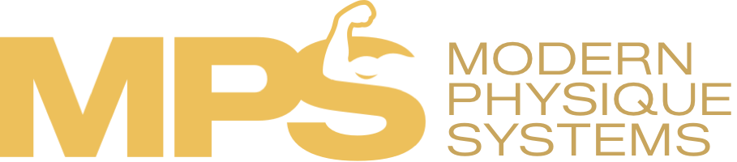
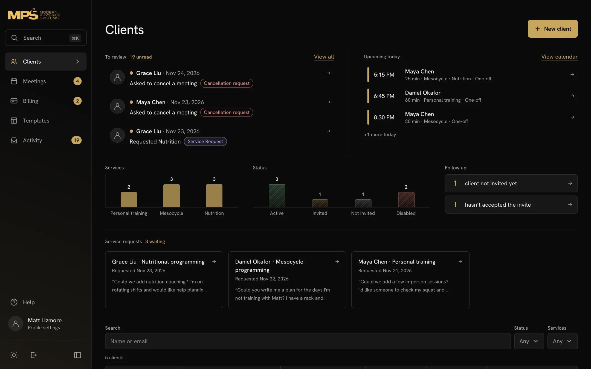
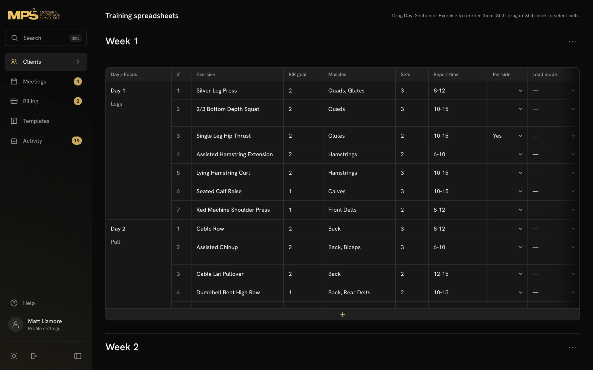
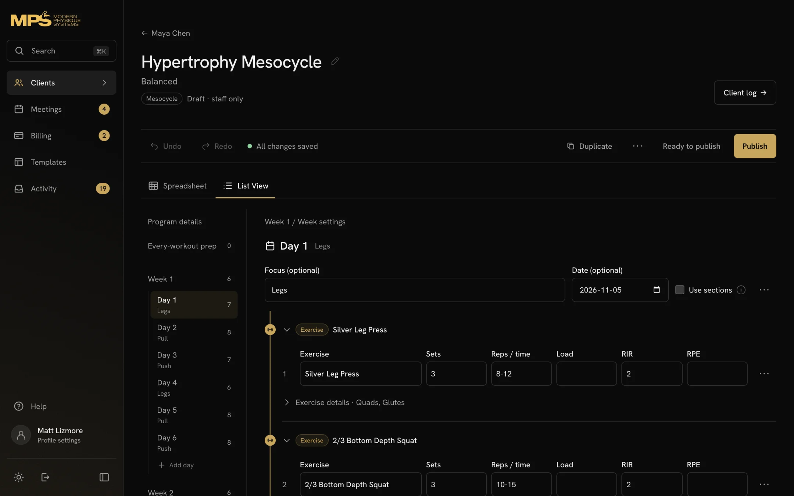
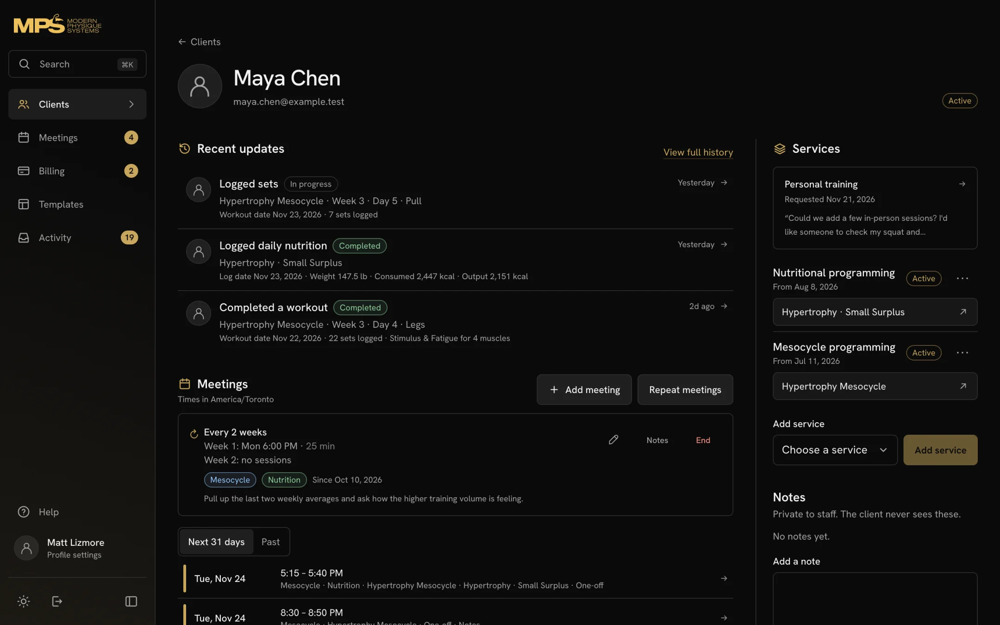
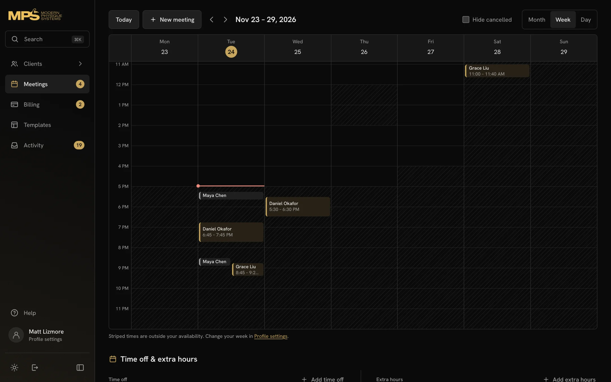
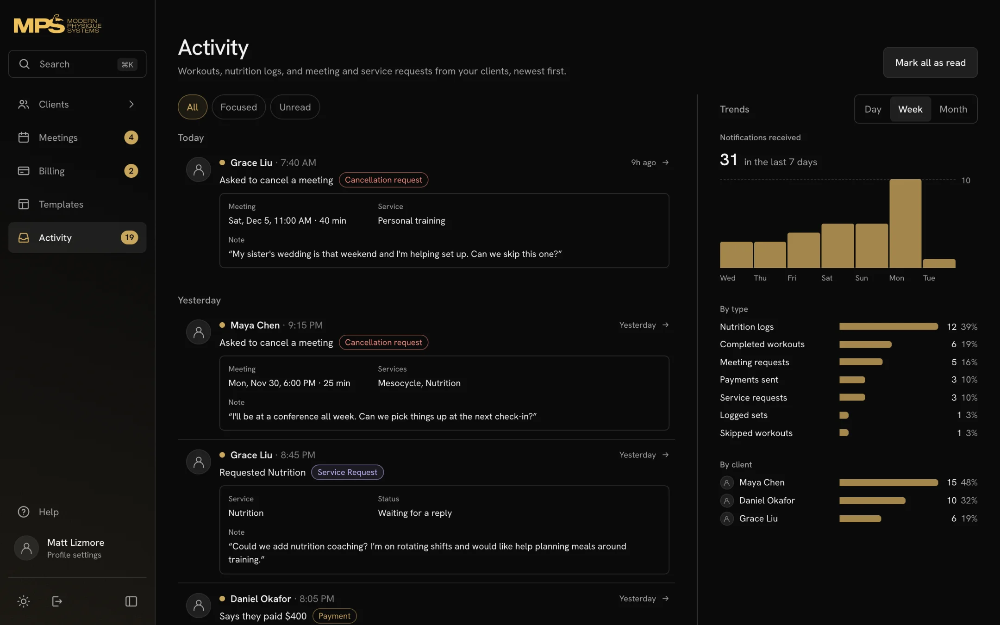
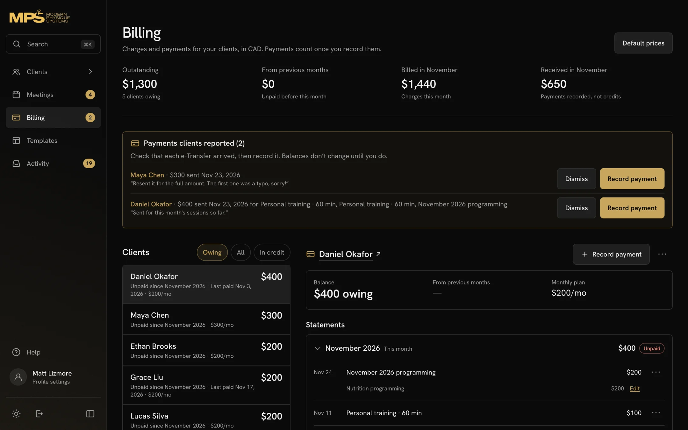
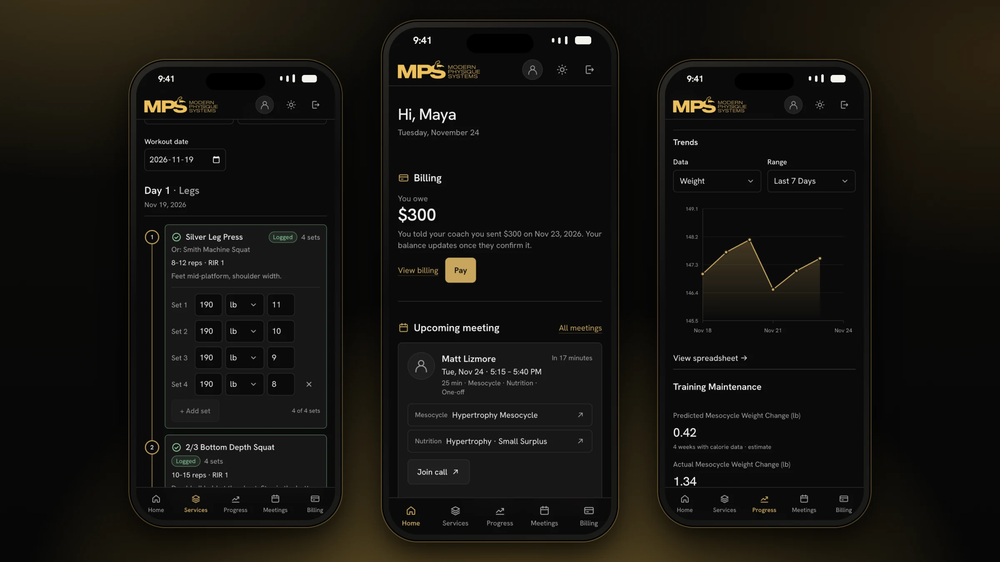
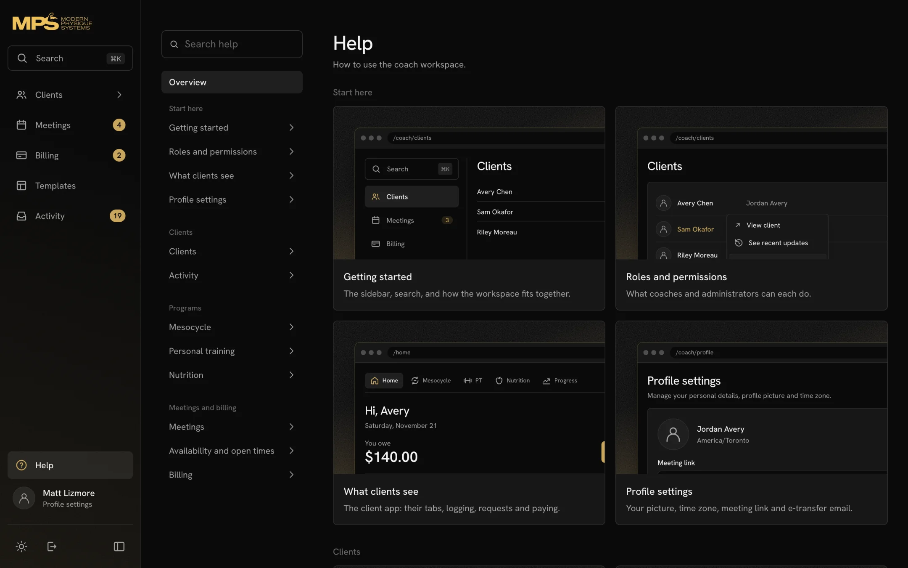

<p align="center">
  <a href="https://www.modernphysiquesystems.com/"></a>
</p>

<p align="center">
  The client and coaching web application for Modern Physique Systems
</p>

<p align="center">
  
  
  
  
</p>

<p align="center">
  
</p>

## About

[Modern Physique Systems](https://www.modernphysiquesystems.com/) (MPS) is a coaching business run by Matt Lizmore. It offers three services: Mesocycle Programming, Nutritional Programming and Personal Training. Its programs and client results currently live in spreadsheets and documents. This application replaces them with one branded, mobile-friendly platform:

- **Coaches** manage clients, publish programs, review activity, schedule meetings and track billing.
- **Clients** see what to do next, log workouts and nutrition on their phone, and track progress.

> [!NOTE]
> **Work in progress.** The application is under active development and this is not the final version. The interface, data model and workflows may change before release.

## Screenshots

All people and data shown are fictional, from the local development seed.

### Coach workspace

<table>
  <tr>
    <td width="33%"><a href="docs/screenshots/coach-grid-dark.webp"></a></td>
    <td width="33%"><a href="docs/screenshots/coach-list-dark.webp"></a></td>
    <td width="33%"><a href="docs/screenshots/coach-client-detail-dark.webp"></a></td>
  </tr>
  <tr>
    <td align="center"><sub><b>Spreadsheet editor.</b> Keyboard navigation, range selection, drag to reorder, copy and paste.</sub></td>
    <td align="center"><sub><b>List View.</b> The same program, edited one day at a time.</sub></td>
    <td align="center"><sub><b>Client page.</b> Recent updates, meetings, services and private staff notes.</sub></td>
  </tr>
  <tr>
    <td width="33%"><a href="docs/screenshots/coach-calendar-dark.webp"></a></td>
    <td width="33%"><a href="docs/screenshots/coach-activity-dark.webp"></a></td>
    <td width="33%"><a href="docs/screenshots/coach-billing-dark.webp"></a></td>
  </tr>
  <tr>
    <td align="center"><sub><b>Meetings.</b> A calendar with availability, drag-to-create and conflict checks.</sub></td>
    <td align="center"><sub><b>Activity.</b> Workouts, nutrition logs and requests, with weekly trends.</sub></td>
    <td align="center"><sub><b>Billing.</b> Balances, statements and payments clients report sending.</sub></td>
  </tr>
</table>

### Client app

<p align="center">
  
</p>

## Features

### For coaches

- **Clients.** Invite clients, enroll them in one or more services, transfer them between coaches, and archive ended services while keeping their history. A `⌘K` / `Ctrl`+`K` command palette jumps to any client or page.
- **Two program editors over one model.** A spreadsheet-style view and a structured List View edit the same canonical program, with undo and redo shared across both.
- **Draft, publish and revise.** Drafts autosave. Publishing creates an immutable revision, so a client's completed history is never rewritten when their program changes. Programs can be duplicated for the next block and downloaded as .xlsx or .json.
- **Nutritional programming.** Targets with effective dates, a coach-editable daily log, weekly averages and calorie balances, and weight-trend charts.
- **Activity.** A feed of client workouts, nutrition entries, feedback and requests, with read state and summary trends.
- **Meetings.** One-off and repeating meetings, coach availability and time off, attendance records, conflict detection, and client requests to book, move or cancel.
- **Billing.** Monthly programming charges, per-session pricing and recorded payments, all in integer cents.
- **Built-in Help.** Searchable Help pages with live examples and animated demos.

### For clients

- A home screen centred on the next action, with navigation filtered to the services they're enrolled in.
- Set-by-set workout logging against the prescribed targets (weights, reps, RIR/RPE ranges), plus muscle-group totals and optional session feedback.
- Daily weigh-ins and nutrition logging, with weekly summaries and progress charts.
- A Personal Training dashboard with upcoming sessions, requests and past programs.
- Billing statements, profile settings, and light and dark themes.

### Spreadsheet importer

A migration pipeline, still in development, turns MPS's existing Excel and Word templates into structured program data. It parses the files directly and never evaluates formulas or macros. Every source item ends up *mapped*, *excluded* (with a reason) or *unresolved* (with an issue for the coach to review), and nothing is applied without the coach's confirmation. The importer has no DOM dependencies, so the same code runs in Node tests and can run in a browser Web Worker.

## Tech stack

| Layer | Tools |
|---|---|
| Front end | React 19, TypeScript, Vite, React Router 7, TanStack Query, Tailwind CSS 4, MDX |
| Validation | Zod 4 at every boundary (forms, API responses, import contracts) |
| Back end | Supabase: Postgres with row-level security, Auth, Storage, Edge Functions (Deno) |
| Testing | Vitest (domain and importer unit tests, HTTP isolation tests), pgTAP (database policy tests) |
| Tooling | pnpm, Supabase CLI, Docker for the local stack |

## Engineering highlights

- **Authorization lives in the database.** Every table, view, function and storage bucket ships with row-level security policies, explicit grants and pgTAP tests in the same migration. Policy helpers run as `security definer` functions in a private schema. Route guards in the UI are a convenience, not a security boundary.
- **Immutability enforced at the data layer.** Published program revisions and session target snapshots can't be modified, and the database enforces this rather than application code.
- **Domain correctness.** Prescribed targets and actual results are stored separately. An RIR of `1-2` is a numeric range, not a date that Excel misread. A null value means "not answered" and is never treated as zero. Money is stored as integer cents.
- **Server-side identity binding.** Client accounts are linked to client records only by an Edge Function during the invitation flow, never by browser input or a matching email address.
- **Shared component library.** Pages are built from one set of accessible components (dialogs, menus, form fields, tabs, charts with screen-reader tables, loading skeletons) and theme tokens, so light and dark modes stay consistent.
- **Recorded decisions.** More than 60 short decision records in [`docs/decisions/`](docs/decisions/) explain the reasoning behind significant design choices.

## Project structure

```text
src/
  app/          Routing, auth context, route guards and layouts
  components/   Shared UI component library
  domain/       Framework-free business logic (programs, training, nutrition, scheduling, billing, importer)
  features/     Feature modules (clients, programs, training, nutrition, scheduling, billing, help, ...)
  lib/          Supabase client, environment validation and theme
supabase/
  migrations/   Schema, RLS policies and database functions
  functions/    Edge Functions (client invitations)
  tests/        pgTAP policy and behaviour tests
tests/          Vitest suites: domain, importer and API isolation
docs/           Product requirements, roadmap, setup guide and decision records
```

## Running locally

Prerequisites: Node 22.12 or later, pnpm 11 and Docker. No hosted accounts are needed.

```sh
pnpm install
pnpm db:start     # start the local Supabase stack
pnpm db:reset     # apply migrations and the fictional seed data
pnpm dev          # after creating .env.local (see docs/setup.md)
```

```sh
pnpm verify       # typecheck, unit tests and production build
pnpm test:db      # database policy tests (pgTAP)
pnpm test:api     # HTTP isolation tests against the local stack
```

See [`docs/setup.md`](docs/setup.md) for environment configuration, the local seed accounts, a demo walkthrough and Edge Function setup.

## Documentation

- [Product requirements](docs/modern-physique-systems-prd.md)
- [Implementation roadmap](docs/modern-physique-systems-implementation-roadmap.md)
- [Development status](docs/status.md)
- [Decision records](docs/decisions/)

Coaches also get Help pages inside the app.

<table>
  <tr>
    <td><a href="docs/screenshots/coach-help-dark.webp"></a></td>
  </tr>
  <tr>
    <td align="center"><sub><b>In-app Help.</b> Searchable pages for every part of the coach workspace, with live examples and animated demos.</sub></td>
  </tr>
</table>

## Ownership and intellectual property

The **Mesocycle Programming**, **Nutritional Programming** and **Personal Training** services, including their programs, templates, training and nutrition methodologies, program content, and coaching workflows, are the intellectual property of **Modern Physique Systems**. The same applies to the Modern Physique Systems name, logo and branding.

They appear in this repository with the owner's permission, for portfolio purposes only. Nothing here grants a licence to use, copy or redistribute that material. All people and data in the local development seed and the screenshots are fictional.

---

<sub>© Modern Physique Systems. The Modern Physique Systems name, logo, services and program content are the property of Modern Physique Systems and are shown here with permission.</sub>
